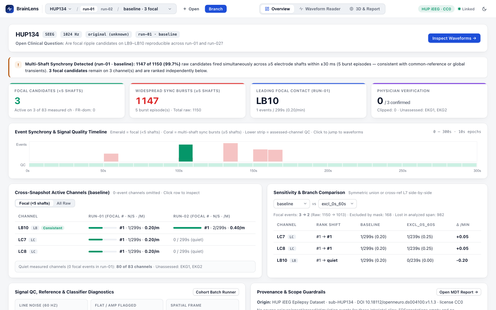
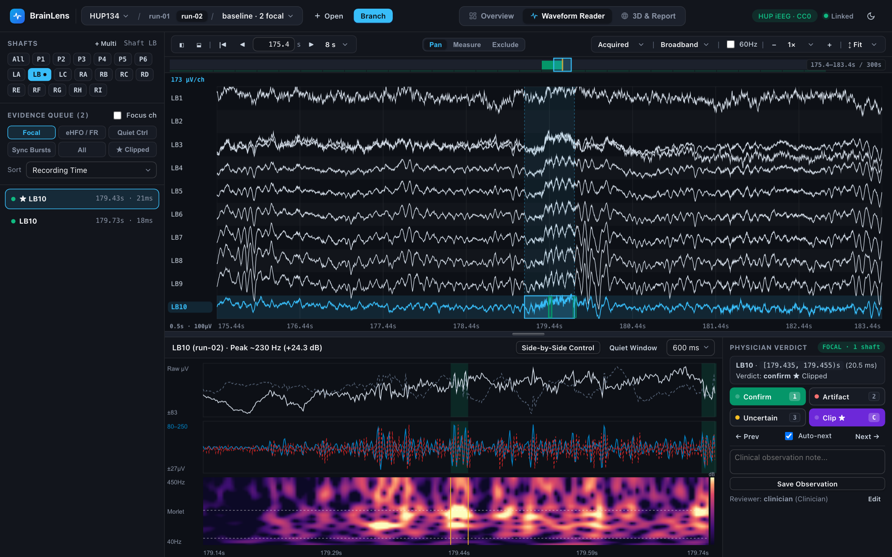
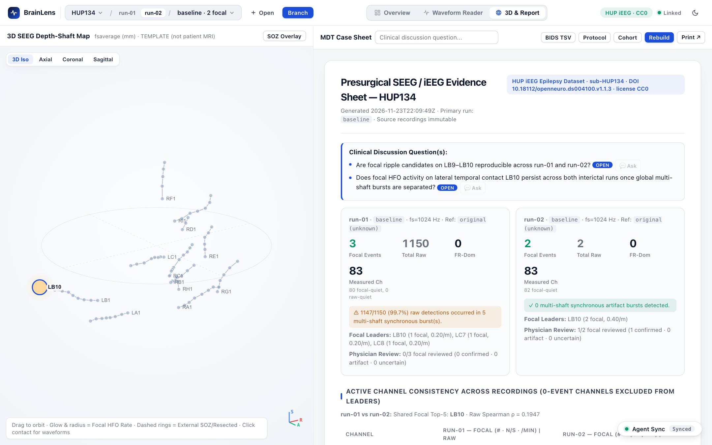

<div align="center">

# BrainLens

**AI co-review for EEG** — from scalp EEG to SEEG: an evidence-grounded EEG / iEEG / SEEG neurophysiology workbench

[](workbench/pyproject.toml)
[](workbench/src/brainlens/mcp_server.py)
[](#supported-formats--signal-guardrails)
[](LICENSE)

*Ask in the case, answer on the waveform — synchronized multi-channel EEG / iEEG / SEEG reader, admission timelines and navigation trends, Clinical Triad inspector, and live MDT case sheets wired directly to **Claude Code**, **Codex**, **Antigravity**, and **Cursor** via MCP.*

</div>

https://github.com/user-attachments/assets/f7095cbc-efe1-4ee4-bf7a-d2962b82e8f0

<p align="center">
  <sub><b>BrainLens 1.0 launch video (~84 s, subtitled):</b> Live walkthrough across two public datasets — opening on the <code>HUP134</code> SEEG case sheet (before any verdicts) as the clinician highlights <code>LB10</code> and asks <i>"Does it recur in run-02?"</i>, watching the open reader jump to <code>run-02 / LB10</code> (~230 Hz) with the agent's reply in the inbox noting that the artifact model scores both events as artifact and flags them for visual review; <b>Case 1 · Scalp EEG</b> (<code>CHB-MIT chb01</code>, PhysioNet, ODC-By 1.0) browsing the 42-file admission timeline, asking <i>"Where are the seizures?"</i> from the waveform reader so the agent searches the timeline via MCP, opens the first annotated onset (<code>chb01_03</code> at <code>49:56</code>) on the 23-channel double-banana montage at <code>1–70 Hz</code>, replies right beside the trace, and pairs with a <code>Line length</code> navigation trend; <b>Case 2 · SEEG</b> (<code>HUP134</code>, OpenNeuro <code>ds004100</code>, CC0) separating multi-shaft bursts from focal candidates, inspecting <code>LB10</code> beside a locked-Y quiet control where the clinician marks <code>Uncertain</code> separately from the agent's <code>Artifact</code> verdict and plain model label, and exporting editable MDT slides in one click. <a href="docs/demo/README.md">Re-render it</a>.</sub>
</p>

---

## Why BrainLens?

Automated EEG and SEEG pipelines often return opaque event tables detached from the underlying waveforms—and force clinicians to bounce manually between vendor viewers, scripts, and slide decks. **BrainLens** keeps raw traces, long-recording timelines and navigation trends, spectral evidence, clinician verdicts, and your AI agent in one synchronized loop across scalp EEG, iEEG, and SEEG:

- **Navigate Long Scalp & Intracranial Recordings on One Clock** — Open multi-file EDF+/BDF+, BrainVision, and native vendor formats (Nihon Kohden, Persyst, Micromed, and more) with inter-file gaps preserved on an admission timeline, use quantitative trends strictly for signal navigation, and jump directly to expert annotations or candidate windows.
- **Ask in the Case, Answer on the Waveform** — Highlight any contact or excerpt on the live MDT Case Sheet and send a question directly to your MCP agent (**Claude Code**, **Codex**, **Antigravity**, or **Cursor**); the agent queries admission timelines or cross-recording evidence, switches your open Waveform Reader live over SSE, and posts its reply inline under your question.
- **See at a Glance Which Detections Fire Together** — On SEEG/iEEG screening runs, cross-shaft synchrony stratification separates widespread multi-shaft bursts (`≥5` electrode shafts within `±30 ms`, e.g., 5 burst episodes on `HUP134/run-01`) from focal candidates (`LB10`, `LC7`, `LC8`), so global transients never distort focal rankings and clicking any burst reveals every co-firing shaft at once.
- **Check the Evidence and Own the Verdict** — Inspect each candidate's multi-channel context and Clinical Triad (raw trace + adjacent differential, ripple/fast-ripple envelope, Morlet time-frequency map) beside a locked-Y quiet control window, then press `1` Confirm, `2` Artifact, or `3` Uncertain—clinician verdicts are persisted separately from researcher, rehearsal, and AI agent assessments.
- **Reviewed Evidence Goes Straight to the MDT** — Export editable MDT PowerPoint slide decks (`.pptx`) carrying the same Clinical Triad figures, focal rankings, and role-separated verdicts in one click, alongside annotated EDF+ / CSV and BIDS `*_events.tsv` exports.

---

## Two Ways to Use BrainLens

| | **BrainLens** (this repository) | **BrainLens Desktop** |
| --- | --- | --- |
| Agent | Your own agent over MCP: **Claude Code**, **Codex**, **Cursor** or **Antigravity** | Built into the app; add a model API key in its settings |
| Runs as | Python package with a local browser workbench and the `brainlens-mcp` server | Electron desktop app |
| Best for | Co-reviewing a case with the agent you already use, through to MDT case sheets and slides | A standalone review app with the agent inside |
| Engine | PyHFO 4 (optional `brainlens[pyhfo]` extra) | PyHFO 4, bundled |
| Get it | [Quick Start](#quick-start-claude-code--codex--cursor--antigravity) below | [roychowdhuryresearch/BrainLens-Desktop](https://github.com/roychowdhuryresearch/BrainLens-Desktop) |

## Quick Start (Claude Code / Codex / Cursor / Antigravity)

BrainLens is **vendor-neutral** by design: one canonical Open Agent Skill ([`skills/brainlens/SKILL.md`](skills/brainlens/SKILL.md)) + one standard stdio MCP server (`brainlens-mcp`) that works identically across **Claude Code**, **Codex**, **Cursor**, **Antigravity**, and any other MCP-compatible agent.

### Option 1 — Ask Your AI Agent to Set Everything Up (Fastest)

Open **Claude Code**, **Codex**, **Cursor**, or **Antigravity** and paste:

```text
Clone https://github.com/zyp5511/BrainLens, install ./workbench into a Python 3.11–3.13 environment,
install the brainlens skill from skills/brainlens/SKILL.md, register the `brainlens` MCP server
(`brainlens-mcp`) pointing at ./workbench_results, and run a quick check on inputs/synthetic_seeg.edf
before opening the BrainLens workbench.
```

> Want HFO detection (`STE`/`MNI`/`HIL`) and 3-stage ONNX scoring (`artifact`/`spike`/`eHFO`) too? Add:
> *"Install the PyHFO 4.x package and fetch its pinned ONNX models using the PyHFO Detection and Classification instructions below."*

### Option 2 — Install in 3 Steps (Any Agent / CLI)

```bash
# 1) Clone & install BrainLens (Python 3.11–3.13)
git clone https://github.com/zyp5511/BrainLens.git
cd BrainLens
pip install ./workbench

# 2) Install the neurophysiology review skill (auto-detects Claude Code, Codex, Cursor, Antigravity)
npx skills add zyp5511/BrainLens

# 3) Register the 7-tool MCP server in your agent
claude mcp add brainlens -- brainlens-mcp --workspace ./workbench_results   # Claude Code
codex mcp add brainlens -- brainlens-mcp --workspace ./workbench_results    # OpenAI Codex CLI
cp .mcp.json.example .mcp.json                                              # Antigravity / Cursor / generic MCP
```

> **Single Canonical Skill**: All neurophysiology review guardrails (QC, Nyquist, focal-vs-burst synchrony, role honesty, and per-recording provenance) live in one portable file at [`skills/brainlens/SKILL.md`](skills/brainlens/SKILL.md).

### Try Asking Your Agent

- *"Inspect `inputs/synthetic_seeg.edf`, run screening, and open the top focal candidate in the waveform reader."*
- *"Screen `inputs/HUP134`, separate focal HFOs from widespread multi-shaft bursts, and check whether the leading contact is consistent across `run-01` and `run-02`."*
- *"Create a sensitivity branch excluding `0–60 s`, compare rank shifts against `baseline`, and export an MDT Case Discussion Sheet."*

> Without PyHFO installed, signal inspection, full QC, Pro Waveform Viewer, Triad verification, and case sheets work immediately with `--no-detector` (`detector_enabled=False`).

---

## Inside the Workbench

BrainLens serves a persistent local web UI (`brainlens-workbench`, light & dark themes, live SSE sync) organized around three focused views:

### 1 · Case Triage Overview
Separates **Focal Candidates (`<5` shafts)** from **Widespread Synchronous Bursts (`≥5` shafts)**, displays unpooled cross-recording consistency (`run-01` vs `run-02`), and runs symmetric sensitivity branch comparisons.

<p align="center">
  
  <br />
  <sub>On <code>HUP134/run-01</code>, BrainLens isolates <b>1,147/1,150 (99.7%)</b> raw detections as 5 multi-shaft burst episodes (coral), surfacing the <b>3 focal candidates</b> (emerald) and highlighting <code>LB10</code> as consistent across both runs.</sub>
</p>

### 2 · Pro Waveform & Clinical Triad Reader
Synchronized multi-channel SEEG/EEG traces (`All` channels with smooth vertical scroll, shaft-by-shaft or multi-shaft `LB + LC`, `Acquired` vs `Adj. Bipolar`, `Broadband` / `1–70 Hz` / `80–250 Hz` / `250–450 FR` + notch, 2D pan, quantitative caliper, Event Minimap) paired with the **Clinical Triad** (raw trace, ripple/fast-ripple envelope, Morlet dB time-frequency island), **Locked-Y Side-by-Side Quiet Control**, and instant keyboard verdicts (`1` Confirm · `2` Artifact · `3` Uncertain · `C` Clip).

<p align="center">
  
  <br />
  <sub>Obsidian Dark Reading Room inspecting <code>HUP134/run-02</code> on depth shaft <code>LB</code> — zoomed <code>LB10</code> ripple candidate (Peak ~230 Hz, +24.3 dB Morlet island) with synchronized multi-channel context and clinician verdict controls.</sub>
</p>

### 3 · 3D Depth Shafts & Interactive MDT Case Sheet
Interactive 3D contact/shaft map alongside a print-ready Presurgical Evidence Sheet with an **Agent Sync Inbox**—clinicians can highlight text, ask questions, or mark verdicts right on the report while the MCP agent replies inline.

<p align="center">
  
  <br />
  <sub>3D fsaverage depth-shaft viewer paired with a live, HMAC-verified MDT Case Discussion Sheet, BIDS <code>*_events.tsv</code> export, and real-time Agent Sync Inbox.</sub>
</p>

---

## 7 Orthogonal MCP Tools

| Tool | Purpose |
| :--- | :--- |
| `inspect_case` | Discover workspace cases/inputs, PyHFO engine health, recording headers, shafts, 3D coordinates, and per-recording provenance; import external anatomy sidecars (with source & patient-native flag) for registered cases. |
| `analyze_case` | Run full-coverage QC, zero-phase SOS prep, PyHFO detection (`STE`/`MNI`/`HIL`), cross-shaft synchrony stratification, and optional ONNX scoring with immutable stage caching. |
| `query_evidence` | Retrieve focal vs burst rankings, symmetric branch sensitivity diffs, unpooled cross-recording concordance, quiet control windows, overlay concordance, cohort summaries, per-contact evidence maps (descriptive convergence), ictal EI (`epileptogenicity`), reader agreement over frozen review sets, per-channel trend overviews (`trends`) and the admission timeline across files (`timeline`). |
| `render_evidence_card` | Export publication-grade 3-panel Clinical Triad PNGs (`top_focal`, `top_burst`, `control`, or explicit `ev_XXXX`), 2-panel 3D/Axial SEEG spatial figures, per-contact evidence-map heatmaps, and ictal EI figures. |
| `open_workbench` | Launch/focus the local Workbench UI, navigate open tabs via SSE, read/resolve clinician annotations on the MDT Case Sheet, or wait in Co-Review standby (`wait_action`). |
| `record_judgment` | Persist deduplicated, role-attributed verdicts (`clinician` / `researcher` / `engineering_rehearsal` / `agent`), clips, clinical questions, source-cited external SOZ/Resected overlays, and external anatomy labels. |
| `export_or_protocol` | Export per-run MDT Case Discussion Sheets (HTML/PDF), MDT slide decks (PPTX), BIDS `*_events.tsv`, or annotated EDF+ and CSV for EEG readers — with optional de-identification (`deidentify` / `pseudonym`) for sharing. Save Group Protocols, run Multi-Patient Cohorts, freeze review sets, and export reader-agreement reports. |

---

## Supported Formats & Signal Guardrails

| Capability | Behavior |
| :--- | :--- |
| **Recording formats** | `.edf`, `.bdf`, `.fif` / `.fif.gz`, BrainVision (`.vhdr`/`.eeg`/`.vmrk`), and BIDS iEEG/EEG directories with `*_channels.tsv` & `*_brainlens.json` (legacy `*_braintoolkit.json` supported). |
| **Vendor recordings** | Opened natively with companion files bound into integrity checks: Nihon Kohden (`.EEG`), Persyst (`.lay`), EEGLAB (`.set`), Neuroscan (`.cnt`), Compumedics Curry 7/8, GDF and Nicolet (`.data`); Micromed (`.TRC`) with `pip install "brainlens[micromed]"`. Natus/XLTEK: export EDF+ from NeuroWorks. See [`docs/vendor-formats.md`](docs/vendor-formats.md). |
| **Long and discontinuous recordings** | Multi-gigabyte files are hashed once and read by window; EDF+D / BDF+D gaps are kept in true time and never bridged by filters or detectors. A trend overview, an admission timeline across files and multi-segment analysis help you choose what to review. See [`docs/long-recordings.md`](docs/long-recordings.md). |
| **Fast Ripple (`250–450 Hz`) physics** | Enabled only when both recording Nyquist (`0.92 × fs/2`) **and** documented hardware lowpass support `≥265 Hz` (`fs ≥ 577 Hz`); honestly reported unavailable otherwise. |
| **ONNX `eHFO` (`model_e`) physics** | Requires `[10, 500] Hz` spectrogram support (`fs ≥ 2000 Hz`). At `1024 Hz`, `artifact` and `spike` run normally while `ehfo` is explicitly reported as `unavailable` (`null`, never `0`). |
| **Reference & ranking honesty** | Guards against double-differencing already-bipolar recordings; excludes 0-event channels from top rankings; never pools rates across separate recordings. |
| **Role & provenance separation** | Clinician verdicts, researcher notes, rehearsal clicks, and AI agent assessments are tracked separately; per-recording provenance is never cross-contaminated across datasets. |

---

## PyHFO Detection and Classification

PyHFO 4.x is the PyHFO team's packaged engine. BrainLens detects it in the active interpreter and runs it in a separate process. To install detection and prepare all three ONNX classifiers in the active BrainLens environment, run this once with network access.

```bash
pip install "brainlens[pyhfo]" && brainlens configure-engine --fetch-models
```

Until the PyHFO wheel is published on your package index, install the supplied wheel together with this checkout using `pip install "./workbench[pyhfo]" build/pyhfo-4.0.0-py3-none-any.whl`, then run `brainlens configure-engine --fetch-models`.

The fetch command uses PyHFO's registry to verify the pinned model and spec files. Detection works without classifier weights. After fetching, `brainlens inspect "*"` shows the engine mode, version and available models. Analysis workers use the cache offline. To select a separate PyHFO 4.x environment, use `brainlens configure-engine --python /path/to/venv/bin/python --fetch-models`.

## Advanced & Manual Setup

<details>
<summary><strong>Advanced / legacy PyHFO source checkout</strong></summary>

<br />

For deployments using the legacy source layout, pin the upstream checkout to commit `c1c7d3fec990e8661604080664766dc1297cbfdc` and register its interpreter and model directory.

```bash
# 1) Clone pinned upstream PyHFO
git clone https://github.com/roychowdhuryresearch/pyHFO.git ~/pyHFO
git -C ~/pyHFO checkout c1c7d3fec990e8661604080664766dc1297cbfdc

# 2) Create a dedicated Python 3.12 engine virtualenv
python3.12 -m venv ~/pyhfo-venv
~/pyhfo-venv/bin/pip install \
  "HFODetector>=0.0.23,<0.1" "mne>=1.7,<2" "numpy>=1.26,<2" "scipy>=1.11,<2" \
  "pandas>=2,<3" "p_tqdm>=1.4,<2" "onnxruntime>=1.18,<2" "matplotlib>=3.8,<4" "openpyxl>=3.1,<4"

# 3) (Optional) Download pinned ONNX classifier weights (artifact, spike, eHFO)
mkdir -p ~/pyhfo-onnx-models/{model_a,model_s,model_e}
curl -fsSL "https://huggingface.co/roychowdhuryresearch/HFO-artifact/resolve/7f95298b60deff4aae8b1ddfe64acda32a1c1fa7/model.onnx" -o ~/pyhfo-onnx-models/model_a/model.onnx
curl -fsSL "https://huggingface.co/roychowdhuryresearch/HFO-artifact/resolve/7f95298b60deff4aae8b1ddfe64acda32a1c1fa7/model.spec.json" -o ~/pyhfo-onnx-models/model_a/model.spec.json
curl -fsSL "https://huggingface.co/roychowdhuryresearch/HFO-spkHFO/resolve/de371a79569e81921e0174a4e440df2383dfdb8b/model.onnx" -o ~/pyhfo-onnx-models/model_s/model.onnx
curl -fsSL "https://huggingface.co/roychowdhuryresearch/HFO-spkHFO/resolve/de371a79569e81921e0174a4e440df2383dfdb8b/model.spec.json" -o ~/pyhfo-onnx-models/model_s/model.spec.json
curl -fsSL "https://huggingface.co/roychowdhuryresearch/HFO-eHFO/resolve/2e59449dd81f588bf1a49bde647cd0e6d1db0a8c/model.onnx" -o ~/pyhfo-onnx-models/model_e/model.onnx
curl -fsSL "https://huggingface.co/roychowdhuryresearch/HFO-eHFO/resolve/2e59449dd81f588bf1a49bde647cd0e6d1db0a8c/model.spec.json" -o ~/pyhfo-onnx-models/model_e/model.spec.json

# 4) Register engine in ~/.brainlens/engine.json (or via BRAINLENS_PYHFO_* env vars)
brainlens configure-engine \
  --source ~/pyHFO \
  --python ~/pyhfo-venv/bin/python \
  --model-cache ~/pyhfo-onnx-models

# 5) Verify live engine import probe
brainlens inspect "*"
```

For CI / containers, set `BRAINLENS_PYHFO_SOURCE`, `BRAINLENS_PYHFO_PYTHON`, and `BRAINLENS_PYHFO_MODEL_CACHE`.

</details>

<details>
<summary><strong>Standalone CLI Reference &amp; Workspace Layout</strong></summary>

<br />

```bash
# Launch the interactive local Workbench UI
brainlens-workbench

# Inspect recordings, registered cases, and engine health
brainlens inspect "*"

# Run baseline screening (add --no-detector without PyHFO, or --classifier for ONNX)
brainlens analyze inputs/synthetic_seeg.edf --run-name baseline

# Sensitivity branch: excluded spans are masked before zero-phase filtering, so QC, prep & detection rerun
brainlens analyze HUP134/run-01 --run-name excl_0s_60s --exclude-interval 0:60

# Downstream-only branch (e.g. ONNX scoring) reuses the cached QC, prep & detection stages
brainlens analyze HUP134/run-02 --run-name onnx_clf --classifier

# Compare runs, render a Clinical Triad card, or export MDT Case Sheet / BIDS TSV
brainlens query HUP134 --mode compare_runs --recording run-01 --run-a baseline --run-b excl_0s_60s
brainlens card HUP134 --recording run-02 --channel LB10 --event top_focal
brainlens export HUP134 --primary-run baseline
brainlens export-bids HUP134 --recording run-02 --run-name baseline
brainlens export-edf HUP134 --recording run-02 --run-name baseline
```

**Export EDF+ for EEG reader** in the MDT Case Sheet pane exports the selected recording and run. The clinical copy preserves the original EDF patient and recording fields, date, time, channel calibration, and annotations. BrainLens verifies every digital sample before publishing the copy.

Select **De-identify for sharing** to export an EDF/CSV, BIDS events, or MDT case sheet for collaborators. Shared files use the label `shared` or a pseudonym you supply, such as `P001`. Multiple recordings receive separate numbered labels. Sharing masks native header identity and replaces the EDF start date while keeping the time of day. BIDS and sidecar-declared participant IDs stay visible. The equivalent CLI options are `--deidentify --pseudonym P001` on `export-edf`, `export-bids`, and `export`. Local review retains clinical provenance. MCP responses mask native header identity in both modes.

For every supported input format, `export-edf` writes an annotation CSV and a provenance JSON. It also writes a signal copy for continuous EDF and EDF+C inputs. Use `--only-confirmed` to filter HFO events to those confirmed by a clinician. Burst episodes remain available as context. Add `--exclude-bursts` to omit both widespread HFOs and burst episodes.

The default workspace is `./workbench_results` (override via `--workspace` or `BRAINLENS_WORKSPACE`).

```text
workbench_results/
├── cases/<case>/
│   ├── case.json
│   ├── judgments.jsonl                   # Append-only, role-attributed verdicts & notes
│   ├── clinical_overlay.json             # Optional source-cited external SOZ / Resected labels
│   ├── cards/*.png                       # Clinical Triad & 3D Spatial PNGs
│   ├── exports/                          # MDT sheets, BIDS events, EDF+ copies & annotation CSV/JSON
│   └── recordings/<rec>/
│       ├── recording.json                # Verified units, shafts, coordinates & provenance
│       ├── _stage_cache/{qc,prepare,detect}/
│       └── runs/<run_name>/
│           ├── channel_rates.csv         # Direct Pandas / R / MATLAB import
│           ├── epoch_rates.csv
│           ├── events.csv
│           └── generations/<gen_id>/     # Immutable MVCC snapshot
├── cohorts/<cohort>/cohort_{summary,channels}.csv
└── protocols/<protocol>.json
```

</details>

<details>
<summary><strong>Included Datasets, Security Model &amp; Backward Compatibility</strong></summary>

<br />

**Included Datasets & Provenance**
- `inputs/synthetic_seeg.edf` (`940 KB`, CC0, bundled) — 6-channel `2000 Hz` synthetic engineering recording for deterministic Ripple, Fast-Ripple, bipolar, and 3-stage ONNX verification.
- `inputs/HUP134/` (sidecars, fsaverage coordinates & `PROVENANCE.json` bundled) — Public CC0 clinical SEEG (`sub-HUP134`, OpenNeuro [`ds004100`](https://openneuro.org/datasets/ds004100) v1.1.3, `1024 Hz`, 83 SEEG + 2 EKG). Raw `.edf` binaries (`~50 MB` each) are excluded via `.gitignore`.
- `inputs/ZurichHFO/` (sidecars, published bipolar pairs, `.vhdr`/`.vmrk` & `PROVENANCE.json` bundled) — Public CC0 iEEG (`sub-01`, OpenNeuro [`ds003498`](https://openneuro.org/datasets/ds003498), `2000 Hz` BrainVision). Raw `.eeg` binary (`114 MB`) is excluded via `.gitignore`.

**Security & Scale Guidance**
- **Single-user loopback (`127.0.0.1`)**: Mutating `POST` routes require a per-session CSRF token (`X-BrainLens-Token`), while read-only `GET` endpoints on loopback are unauthenticated—do not expose the workbench port to a network or run on an untrusted multi-user host.
- **Untrusted workspace protection**: Workspace-local `<workspace>/engine.json` files are ignored unless `BRAINLENS_ALLOW_WORKSPACE_ENGINE=1` is explicitly set; exported MDT case sheets are signed against an out-of-workspace HMAC-SHA256 trust store (`~/.brainlens/`).
- **Interactive file size guidance**: Because the Waveform Reader performs SHA-256 source integrity verification around disk reads, interactive browsing is tuned for review segments **≤ ~1 GB per recording**.
- **Legacy compatibility**: Existing `BTK_*` / `BRAINTOOLKIT_*` environment variables, `~/.braintoolkit/engine.json`, `*_braintoolkit.json` sidecars, and `X-BTK-Token` headers remain supported as fallbacks.

</details>

---

## Documentation

- [`docs/anatomy-labels.md`](docs/anatomy-labels.md) — Importing and displaying external anatomical labels (CSV/TSV/BIDS electrodes) with source and patient-native provenance.
- [`docs/reader-conventions.md`](docs/reader-conventions.md) — Waveform reader display conventions: sensitivity, screen calibration, timebase, paging, and display filters.
- [`docs/evidence-map.md`](docs/evidence-map.md) — The multi-biomarker evidence map (focal ripple/FR, ONNX spike, IED candidates) and ictal Epileptogenicity Index computation.
- [`docs/reader-agreement.md`](docs/reader-agreement.md) — Independent reader review sets, blinding, and inter-rater agreement statistics (percent agreement, Cohen's/Fleiss' κ).
- [`docs/mdt-slides.md`](docs/mdt-slides.md) — One-click MDT PowerPoint export: deck contents, evidence selection, identity/de-identification rules, and CLI/MCP/HTTP usage.
- [`docs/i18n.md`](docs/i18n.md) — Workbench display language (EN / 简体中文) and how to add translatable UI text.
- [`docs/long-recordings.md`](docs/long-recordings.md) — Large and discontinuous (EDF+D) recordings, the trend overview, the admission timeline, and multi-segment analysis.
- [`docs/vendor-formats.md`](docs/vendor-formats.md) — Native vendor formats (Nihon Kohden, Persyst, EEGLAB, Neuroscan, Curry, GDF, Nicolet, Micromed), companion files, identity masking, and Natus export guidance.
- [`docs/deployment.md`](docs/deployment.md) — Hospital and air-gapped workstation installation, offline bundles, and Docker deployment.
- [`CHANGELOG.md`](CHANGELOG.md) — Release history: what was added, changed, and fixed in each version.

---

## Clinical Scope & License

> **Research & Clinical Decision-Support Scope**: BrainLens is **not a medical device** and does not establish seizure onset zones (SOZ) or surgical resection boundaries. All automated counts and classifier scores require visual verification alongside ictal EEG, MRI/PET anatomy, neuropsychology, and electrode coverage by qualified clinicians.

Released under the [MIT License](LICENSE). Bundled example fixtures retain their documented CC0 dedications.
